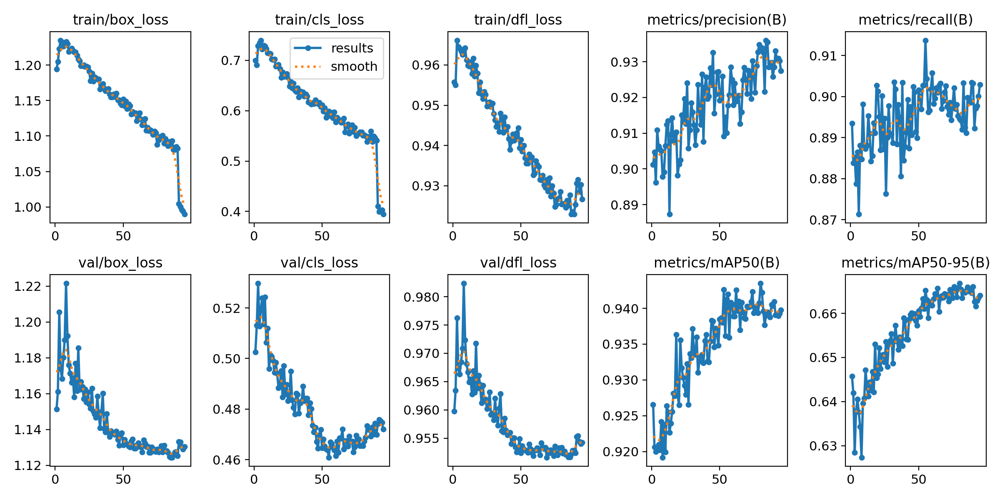
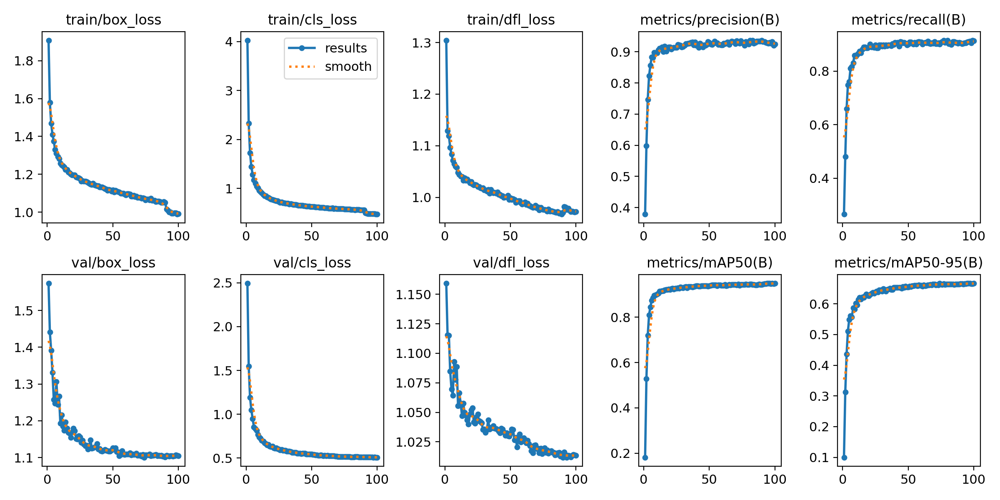
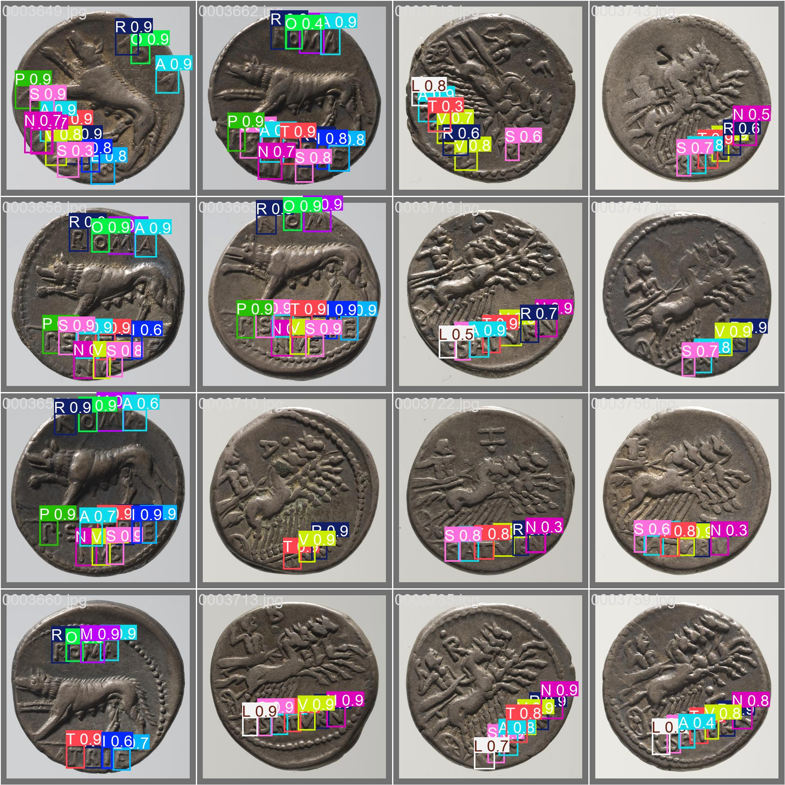
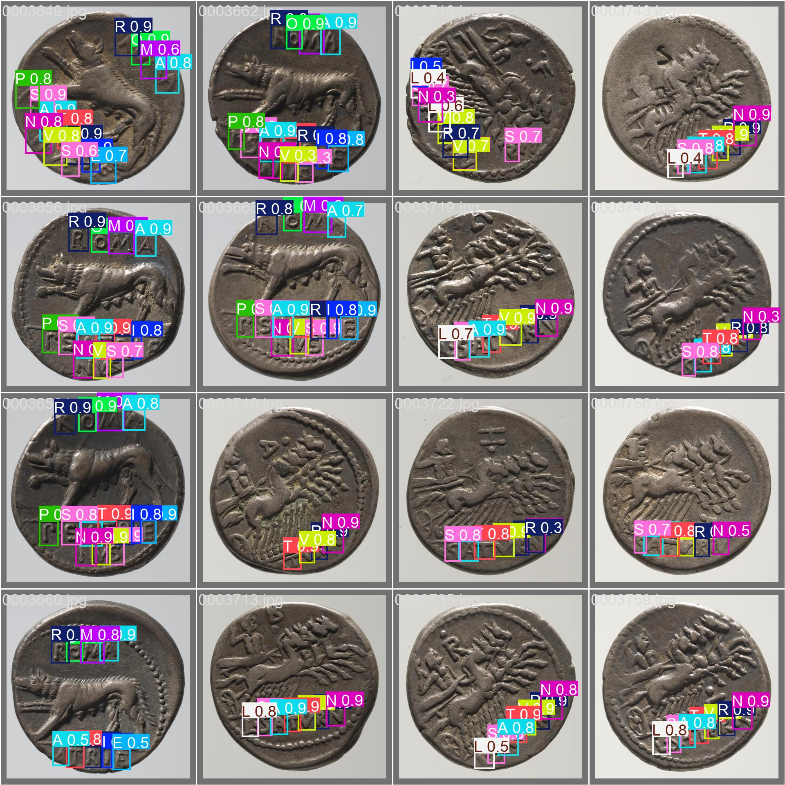

# Coin Detection Using YOLOv10 and YOLOv11

A computer vision project focused on coin detection using YOLOv10 and YOLOv11 object detection models. The project explores eight model configurations, compares their recorded performance, and includes training visualizations, validation predictions, and evaluation results.

## Objectives

- Train and evaluate YOLOv10 and YOLOv11 for coin detection.
- Compare Nano (n), Small (s), Medium (m), and Large (l) model variants.
- Analyze training and validation metrics.
- Visualize predictions using bounding boxes and class confidence scores.
- Provide an inference script and example images.

## Models

The experiments cover the following model configurations:

| Model Family | Variants |
|---|---|
| YOLOv10 | YOLOv10n, YOLOv10s, YOLOv10m, YOLOv10l |
| YOLOv11 | YOLOv11n, YOLOv11s, YOLOv11m, YOLOv11l |

## Dataset

The full dataset is not included in this public repository.

The dataset contains 20 classes. To request access, visit the Google Drive folder below and submit an access request. Access is subject to approval.

**[Request Dataset Access on Google Drive](https://drive.google.com/drive/folders/1INE-aqAdnukjRm4A8BkR6zzDKHY5i0dO?usp=drive_link)**

The dataset and annotations are stored separately from this repository.

## Repository Structure

```text
coin-detection-yolo/
├── configs/
├── docs/
│   └── USAGE.md
├── examples/
│   └── images/
├── results/
│   ├── yolo10/
│   │   ├── model_n/
│   │   ├── model_s/
│   │   ├── model_m/
│   │   └── model_l/
│   ├── yolo11/
│   │   ├── model_n/
│   │   ├── model_s/
│   │   ├── model_m/
│   │   └── model_l/
│   ├── model_comparison.csv
│   └── comparison.md
├── scripts/
├── src/
│   └── predict.py
├── .gitignore
├── requirements.txt
└── README.md
```

Each model directory contains selected experiment artifacts, including training metrics, result plots, confusion matrices, F1 curves, training arguments, and validation batch visualizations.

## Installation

### 1. Clone the Repository

```bash
git clone https://github.com/YOUR_USERNAME/coin-detection-yolo.git
cd coin-detection-yolo
```

Replace `YOUR_USERNAME` with your GitHub username.

### 2. Create a Virtual Environment

```bash
python3 -m venv .venv
source .venv/bin/activate
```

### 3. Install Dependencies

```bash
python -m pip install --upgrade pip
pip install -r requirements.txt
```

The dependency versions should be verified against the environment used for inference.

## Inference

The repository includes an inference script at `src/predict.py`. A compatible trained model weights file is required to run predictions.

Trained weights are not included in this public repository. Obtain an authorized weights file separately and keep it outside the repository.

### Run Inference on One Image

```bash
python src/predict.py \
  --weights ~/models/coin-model.pt \
  --source examples/images/0003649.jpg
```

Replace the example weights path with the actual location of your model file.

### Run Inference on All Example Images

```bash
python src/predict.py \
  --weights ~/models/coin-model.pt \
  --source examples/images/
```

### Change the Confidence Threshold

```bash
python src/predict.py \
  --weights ~/models/coin-model.pt \
  --source examples/images/0003649.jpg \
  --conf 0.40
```

The default confidence threshold is `0.25`.

Prediction outputs are saved under `runs/coin-predictions/results/` by default.

See [`docs/USAGE.md`](docs/USAGE.md) for additional instructions.

## Results

The following graphs provide a quick overview of the training results. Detailed artifacts for all eight model configurations are available in the repository.

### YOLOv10



### YOLOv11



### Explore All Results

- [YOLOv10 experiment artifacts](results/yolo10/)
- [YOLOv11 experiment artifacts](results/yolo11/)
- [Complete model comparison](results/comparison.md)
- [Recorded metrics in CSV format](results/model_comparison.csv)

The comparison table reports metrics from the final recorded epoch of each training run. These values may differ from the best-performing checkpoint and should be interpreted in that context.

## Validation Predictions

The following images show examples of validation predictions produced during the experiments. Colored bounding boxes and labels visualize the model's detections.

### YOLOv10



### YOLOv11



Additional prediction batches and ground-truth label visualizations are available in the corresponding model directories:

- [YOLOv10 Nano](results/yolo10/model_n/)
- [YOLOv10 Small](results/yolo10/model_s/)
- [YOLOv10 Medium](results/yolo10/model_m/)
- [YOLOv10 Large](results/yolo10/model_l/)
- [YOLOv11 Nano](results/yolo11/model_n/)
- [YOLOv11 Small](results/yolo11/model_s/)
- [YOLOv11 Medium](results/yolo11/model_m/)
- [YOLOv11 Large](results/yolo11/model_l/)

The `val_batch*_pred.jpg` files contain model predictions, while `val_batch*_labels.jpg` files show the corresponding ground-truth annotations.

## Model Weights

Trained model weights (`.pt` files) are not included in this public repository. They are stored separately and are not distributed through GitHub.

## Limitations

- Running inference requires a compatible trained weights file.
- Metrics in the comparison table come from the final recorded epoch, not necessarily the best checkpoint.
- Training and validation visualizations reflect the recorded experiments.
- Dataset access and redistribution are subject to the dataset owner's approval and applicable permissions.

## License

A license has not yet been added. Licensing terms will be decided before the project is published for reuse.
