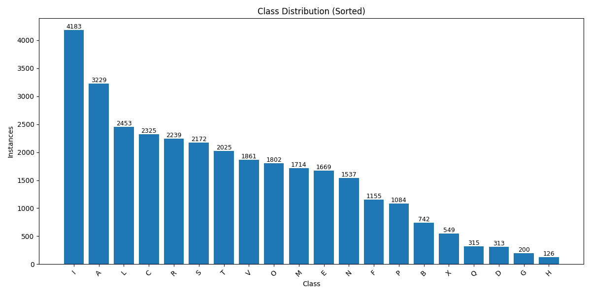
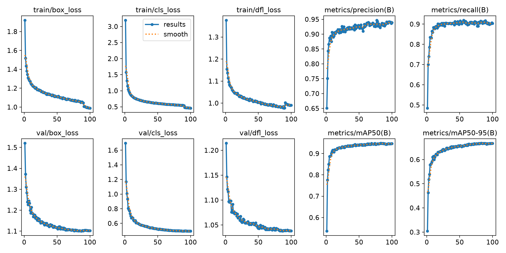
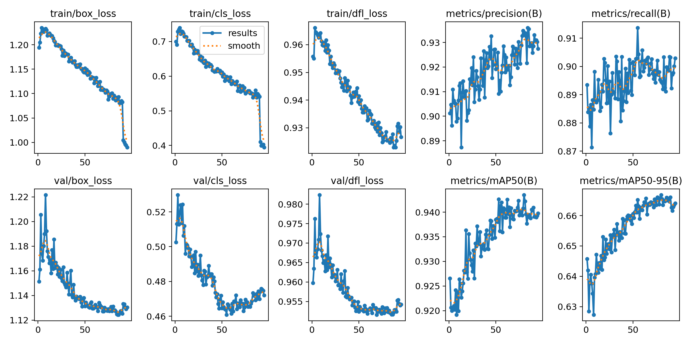
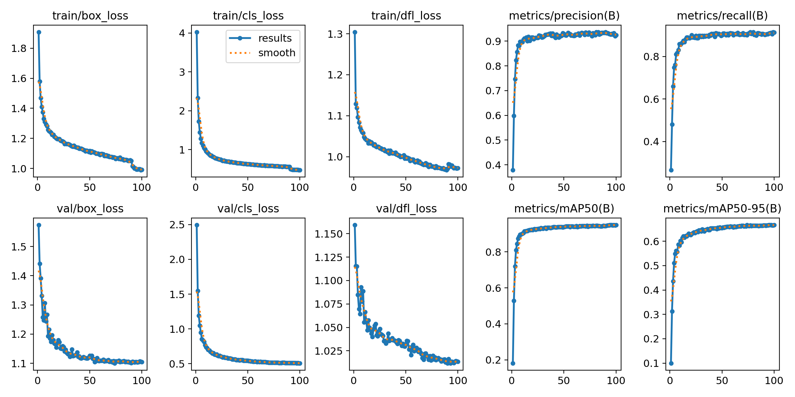
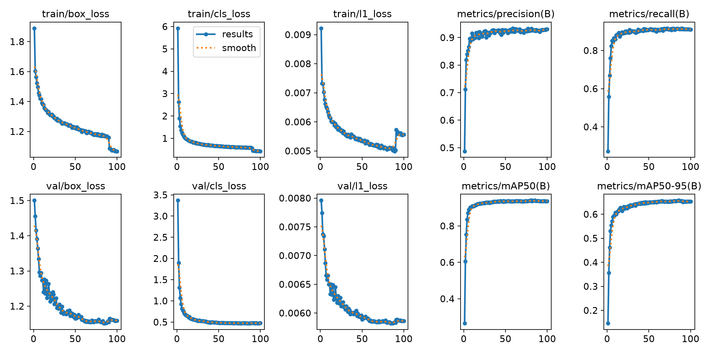
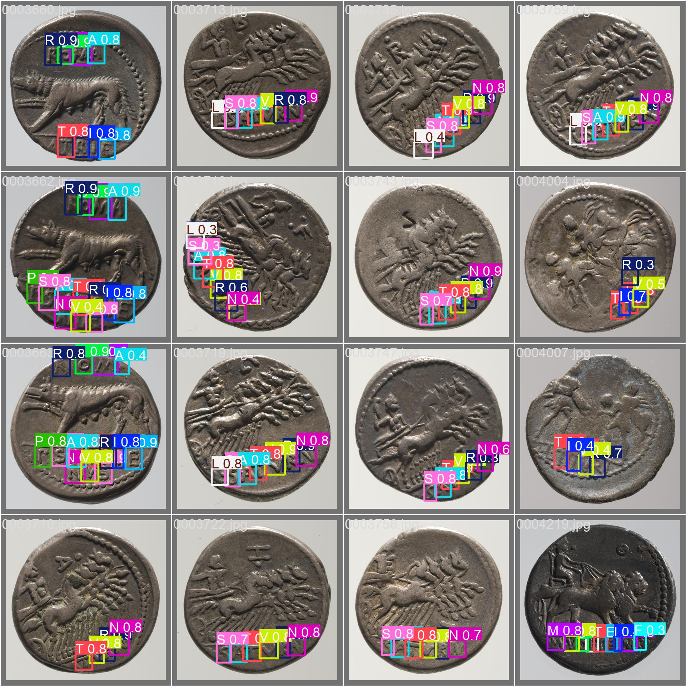
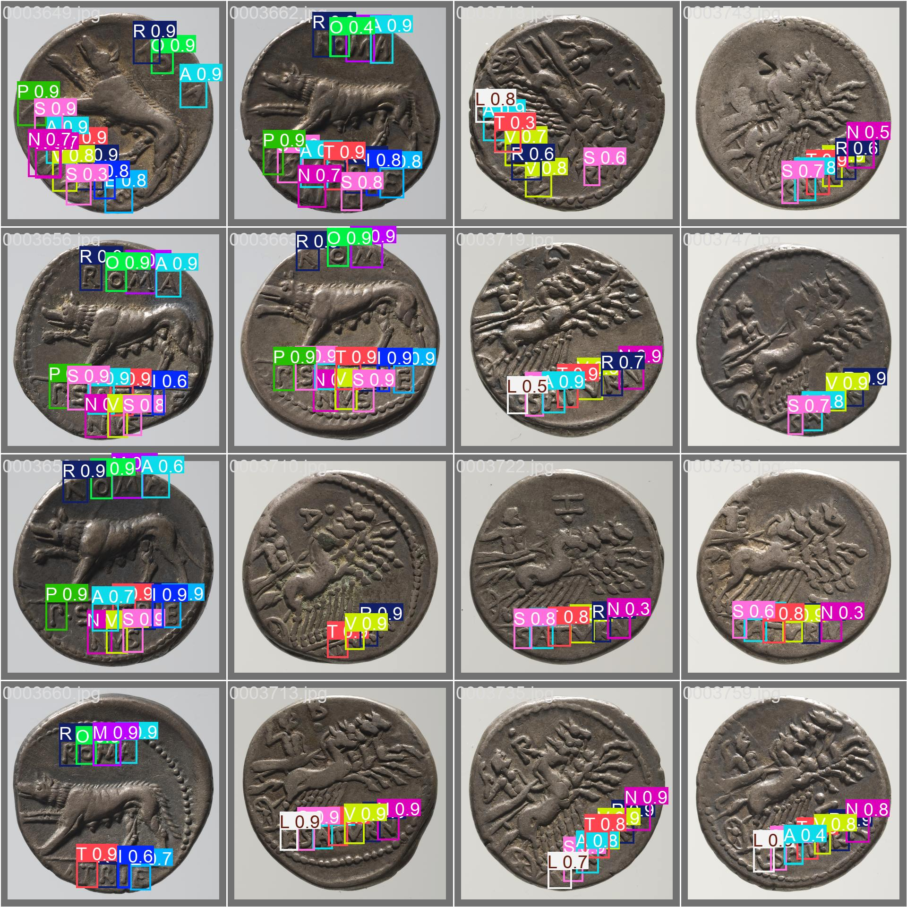
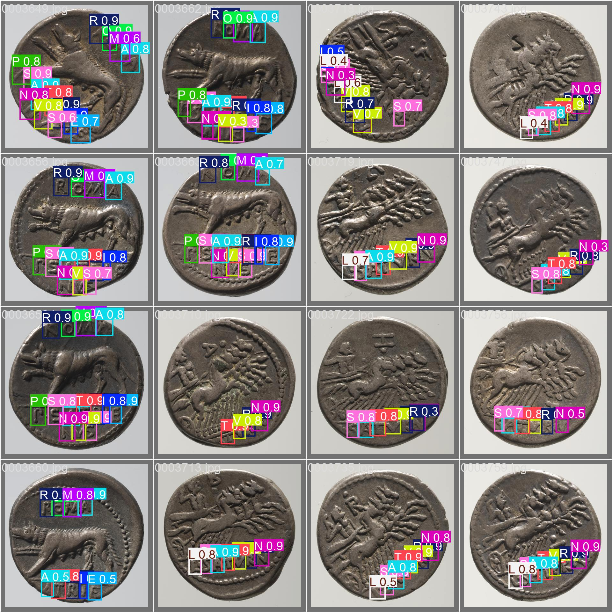
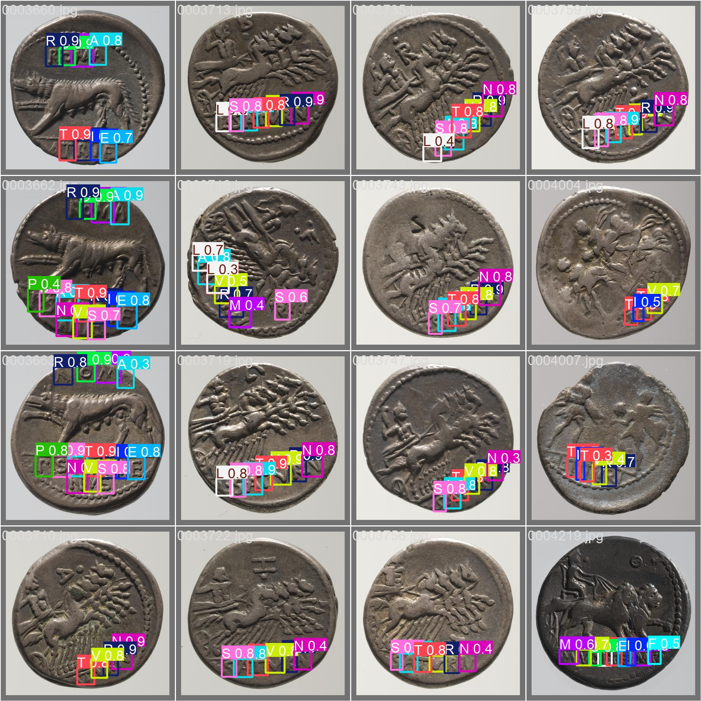

# Coin Detection Using YOLOv8, YOLOv10, YOLOv11 and YOLO26

A computer vision project focused on coin detection using YOLOv8, YOLOv10, YOLOv11 and YOLO26 object detection models. The project explores sixteen model configurations, compares their recorded performance, and includes training visualizations, validation predictions, and evaluation results.

## Objectives

- Train and evaluate YOLOv8, YOLOv10, YOLOv11 and YOLO26 for coin detection.
- Compare Nano (n), Small (s), Medium (m), and Large (l) model variants.
- Analyze training and validation metrics.
- Visualize predictions using bounding boxes and class confidence scores.
- Provide an inference script and example images.

## Dataset Overview

The coin dataset contains 4,678 training images and 1,001 validation images across 20 classes.

> **Note:** the YOLOv8 and YOLO26 experiments were run after removing 15 images whose label files were empty (12 from train, 3 from val), so they used 4,665 training and 998 validation images. The YOLOv10 and YOLOv11 experiments used the full 4,678 / 1,001 split.

### Class Distribution

The chart below shows the number of instances per class, sorted from highest to lowest frequency.



The dataset has an imbalanced class distribution. Therefore, model performance should be evaluated using multiple metrics, including precision, recall, mAP@50, and mAP@50–95.

### Dataset Configuration

The YOLO dataset configuration is available here:

[`configs/coins.yaml`](configs/coins.yaml)

The full dataset is not included in this repository. Contact the repository owner to request access to the dataset.

## Dataset Preprocessing

The `scripts/` directory contains utilities for dataset preprocessing and analysis.

- [`coins.py`](scripts/coins.py) — converts Pascal VOC XML annotations into YOLO format and normalizes known label variations.
- [`class_distribution.py`](scripts/class_distribution.py) — counts class instances from YOLO label files and generates a class distribution chart.

These scripts require the appropriate local dataset paths to be configured before execution.

## Experiment Report

The complete experiment report is available below:

[**View the Coins Report (PDF)**](docs/dataset/Coins_Report.pdf)

The report contains dataset information and evaluation results for the YOLOv10 and YOLOv11 model variants (pages 1–7), followed by the YOLOv8 and YOLO26 results (pages 8–13): a summary table, training curves for every model, and the per-class AP of the Top-3 models. The same results are also in [`results/comparison.md`](results/comparison.md).

## Reproducibility

To reproduce the experiments, you will need:

- Python installed in your environment.
- The dependencies listed in [`requirements.txt`](requirements.txt).
- Access to the coin dataset.
- Trained model weights (the Top-3 are included in [`weights/`](weights/)).

Refer to [`docs/USAGE.md`](docs/USAGE.md) for usage instructions.

### Train and compare models

[`scripts/train_compare.py`](scripts/train_compare.py) trains YOLOv8 and YOLO26 (n/s/m/l), plots train/validation loss and accuracy graphs, builds the comparison table, and reports the per-class AP of the Top-3 models. Each model is saved in its own folder. Edit the paths at the top of the script (`DATA`, `OUT_DIR`) and run:

```bash
python scripts/train_compare.py
```

Use `--stage train` to only train, or `--stage report` to only rebuild the tables and graphs. Re-running resumes unfinished runs and skips finished ones.

## Models

The experiments cover the following model configurations:

| Model Family | Variants |
|---|---|
| YOLOv8 | YOLOv8n, YOLOv8s, YOLOv8m, YOLOv8l |
| YOLOv10 | YOLOv10n, YOLOv10s, YOLOv10m, YOLOv10l |
| YOLOv11 | YOLOv11n, YOLOv11s, YOLOv11m, YOLOv11l |
| YOLO26 | YOLO26n, YOLO26s, YOLO26m, YOLO26l |

YOLOv8 and YOLO26 were trained for the full 100 epochs with `imgsz=448`, `batch=16`, `seed=0` and default augmentation, using [`scripts/train_compare.py`](scripts/train_compare.py). The same script builds the comparison table, the train/validation graphs and the per-class AP tables.

## Dataset

The full dataset is not included in this public repository.

The dataset contains 20 classes. To request access, visit the Google Drive folder below and submit an access request. Access is subject to approval.

**[Request Dataset Access on Google Drive](https://drive.google.com/drive/folders/1INE-aqAdnukjRm4A8BkR6zzDKHY5i0dO?usp=drive_link)**

The dataset and annotations are stored separately from this repository.

## Repository Structure

```text
coin-detection-yolo/
├── configs/
├── docs/
│   └── USAGE.md
├── examples/
│   └── images/
├── results/
│   ├── yolo8/
│   │   └── model_n/ model_s/ model_m/ model_l/
│   ├── yolo10/
│   │   ├── model_n/
│   │   ├── model_s/
│   │   ├── model_m/
│   │   └── model_l/
│   ├── yolo11/
│   │   ├── model_n/
│   │   ├── model_s/
│   │   ├── model_m/
│   │   └── model_l/
│   ├── yolo26/
│   │   └── model_n/ model_s/ model_m/ model_l/
│   ├── model_comparison.csv
│   ├── comparison.md
│   └── top3_per_class_ap.md
├── scripts/
├── src/
│   └── predict.py
├── weights/
│   └── yolov8n_best.pt, yolov8s_best.pt, yolo26s_best.pt
├── .gitignore
├── requirements.txt
└── README.md
```

Each model directory contains selected experiment artifacts, including training metrics, result plots, confusion matrices, F1 curves, training arguments, and validation batch visualizations.


## Inference

The repository includes an inference script at `src/predict.py`. A compatible trained model weights file is required to run predictions.

The Top-3 YOLOv8 / YOLO26 weights are included in [`weights/`](weights/) (see [Model Weights](#model-weights)). For other models, obtain a compatible weights file separately.

### Run Inference on One Image

```bash
python src/predict.py \
  --weights ~/models/coin-model.pt \
  --source examples/images/0003649.jpg
```

Replace the example weights path with the actual location of your model file.

### Run Inference on All Example Images

```bash
python src/predict.py \
  --weights ~/models/coin-model.pt \
  --source examples/images/
```

### Change the Confidence Threshold

```bash
python src/predict.py \
  --weights ~/models/coin-model.pt \
  --source examples/images/0003649.jpg \
  --conf 0.40
```

The default confidence threshold is `0.25`.

Prediction outputs are saved under `runs/coin-predictions/results/` by default.

See [`docs/USAGE.md`](docs/USAGE.md) for additional instructions.

## Results

The following graphs provide a quick overview of the training results. Detailed artifacts for all sixteen model configurations are available in the repository.

### YOLOv8



### YOLOv10



### YOLOv11



### YOLO26



### Full Comparison (16 models)

Metrics from the final recorded epoch of each run, sorted by mAP@50. YOLOv8 and YOLO26 were trained for the full 100 epochs; the YOLOv10 and YOLOv11 runs recorded fewer epochs (58–100) and used the full dataset (see the note in [Dataset Overview](#dataset-overview)).

| Rank | Model | Epochs | Precision | Recall | mAP@50 | mAP@50–95 |
|---|---|---|---|---|---|---|
| 1 | yolo11_n | 100 | 0.9244 | 0.9131 | 0.9495 | 0.6669 |
| 2 | yolo11_s | 84 | 0.9286 | 0.9124 | 0.9491 | 0.6704 |
| 3 | yolo8_n | 100 | 0.9393 | 0.9036 | 0.9467 | 0.6674 |
| 4 | yolo8_s | 100 | 0.9391 | 0.9004 | 0.9444 | 0.6642 |
| 5 | yolo11_m | 73 | 0.9385 | 0.9043 | 0.9438 | 0.6676 |
| 6 | yolo11_l | 68 | 0.9204 | 0.9146 | 0.9431 | 0.6691 |
| 7 | yolo26_s | 100 | 0.9322 | 0.9017 | 0.9399 | 0.6597 |
| 8 | yolo10_n | 95 | 0.9274 | 0.9029 | 0.9398 | 0.6640 |
| 9 | yolo10_s | 77 | 0.9251 | 0.9019 | 0.9387 | 0.6629 |
| 10 | yolo10_l | 58 | 0.9143 | 0.9087 | 0.9375 | 0.6695 |
| 11 | yolo26_n | 100 | 0.9300 | 0.9098 | 0.9366 | 0.6527 |
| 12 | yolo8_m | 100 | 0.9260 | 0.9041 | 0.9349 | 0.6495 |
| 13 | yolo10_m | 61 | 0.9384 | 0.8998 | 0.9329 | 0.6646 |
| 14 | yolo26_l | 100 | 0.9348 | 0.9025 | 0.9326 | 0.6592 |
| 15 | yolo26_m | 100 | 0.9376 | 0.8996 | 0.9317 | 0.6530 |
| 16 | yolo8_l | 100 | 0.9198 | 0.9095 | 0.9262 | 0.6427 |

### Top-3 YOLOv8 / YOLO26 Models

Ranked by mAP@50 (final epoch) among the YOLOv8 and YOLO26 models:

| Rank | Model | Precision | Recall | mAP@50 | mAP@50–95 |
|---|---|---|---|---|---|
| 1 | yolov8n | 0.9393 | 0.9036 | 0.9467 | 0.6674 |
| 2 | yolov8s | 0.9391 | 0.9004 | 0.9444 | 0.6642 |
| 3 | yolo26s | 0.9322 | 0.9017 | 0.9399 | 0.6597 |

Per-class AP for these three models is in [`results/top3_per_class_ap.md`](results/top3_per_class_ap.md). Class `G` is the weakest (AP@50 about 0.59–0.63); it is one of the rarest classes in the dataset.

### Explore All Results

- [YOLOv8 experiment artifacts](results/yolo8/)
- [YOLOv10 experiment artifacts](results/yolo10/)
- [YOLOv11 experiment artifacts](results/yolo11/)
- [YOLO26 experiment artifacts](results/yolo26/)
- [Per-class AP of the Top-3 models](results/top3_per_class_ap.md)
- [Complete model comparison](results/comparison.md)
- [Recorded metrics in CSV format](results/model_comparison.csv)

The comparison table reports metrics from the final recorded epoch of each training run. These values may differ from the best-performing checkpoint and should be interpreted in that context.

## Validation Predictions

The following images show examples of validation predictions produced during the experiments. Colored bounding boxes and labels visualize the model's detections.

### YOLOv8



### YOLOv10



### YOLOv11



### YOLO26



Additional prediction batches and ground-truth label visualizations are available in the corresponding model directories:

- [YOLOv8 Nano](results/yolo8/model_n/), [Small](results/yolo8/model_s/), [Medium](results/yolo8/model_m/), [Large](results/yolo8/model_l/)
- [YOLO26 Nano](results/yolo26/model_n/), [Small](results/yolo26/model_s/), [Medium](results/yolo26/model_m/), [Large](results/yolo26/model_l/)
- [YOLOv10 Nano](results/yolo10/model_n/)
- [YOLOv10 Small](results/yolo10/model_s/)
- [YOLOv10 Medium](results/yolo10/model_m/)
- [YOLOv10 Large](results/yolo10/model_l/)
- [YOLOv11 Nano](results/yolo11/model_n/)
- [YOLOv11 Small](results/yolo11/model_s/)
- [YOLOv11 Medium](results/yolo11/model_m/)
- [YOLOv11 Large](results/yolo11/model_l/)

The `val_batch*_pred.jpg` files contain model predictions, while `val_batch*_labels.jpg` files show the corresponding ground-truth annotations.

## Model Weights

The weights (`best.pt`) of the Top-3 YOLOv8 / YOLO26 models are included in [`weights/`](weights/):

| File | Model | mAP@50 | mAP@50–95 | Size |
|---|---|---|---|---|
| [`yolov8n_best.pt`](weights/yolov8n_best.pt) | YOLOv8n | 0.9467 | 0.6674 | 6.2 MB |
| [`yolov8s_best.pt`](weights/yolov8s_best.pt) | YOLOv8s | 0.9444 | 0.6642 | 21.5 MB |
| [`yolo26s_best.pt`](weights/yolo26s_best.pt) | YOLO26s | 0.9399 | 0.6597 | 19.4 MB |

Example:

```bash
python src/predict.py --weights weights/yolov8n_best.pt --source examples/images/0003649.jpg
```

Weights of the other trained models (and of the YOLOv10 / YOLOv11 runs) are not included in this repository.

